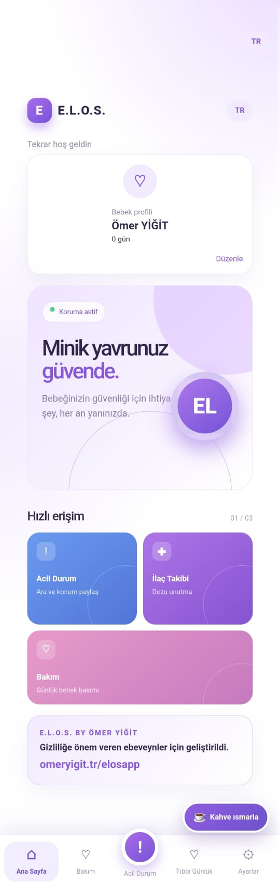
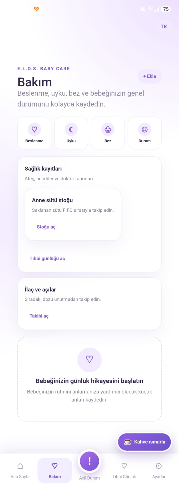
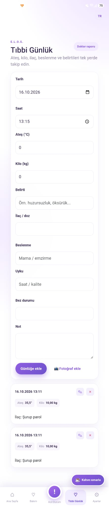
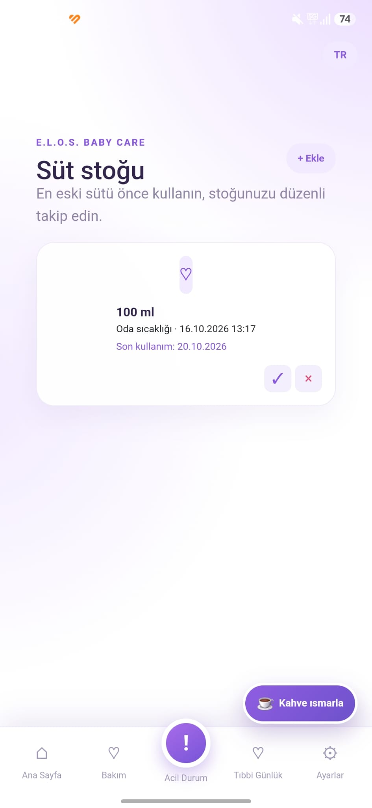
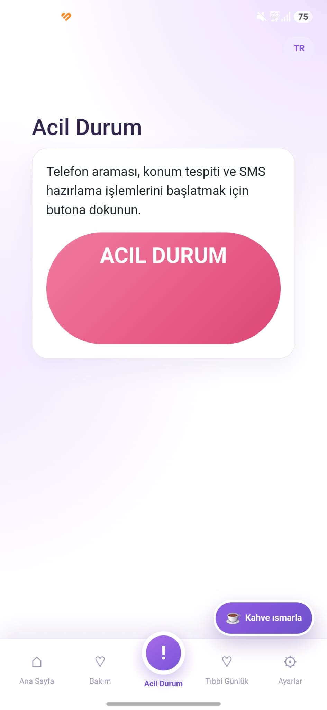
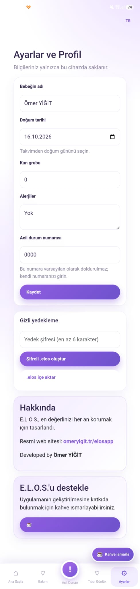

# E.L.O.S. (Early Life Offline Security) 🍼🛡️

**E.L.O.S.**, yeni doğan ve küçük çocuk sahibi ebeveynler için geliştirilmiş, günlük bakım süreçlerini kolaylaştıran ve kritik bilgileri her an erişilebilir tutan, **%100 çevrimdışı ve gizlilik odaklı** bir bebek bakım ve güvenlik asistanıdır.

Bulut dayatması, zorunlu üyelik veya internet bağlantısı gerektirmez. Tüm veriler cihazınızın yerel depolama alanında tutulur ve `.elos` uzantılı AES-256 şifreli yedekler halinde dışa aktarılabilir.

## 🌟 Temel Özellikler

*   **🔒 Tamamen Çevrimdışı & Güvenli:** Verileriniz asla uzak bir sunucuya gönderilmez. Fotoğraflar ve kayıtlar cihazınızda şifrelenerek saklanır.
*   **🚨 Acil Durum Modülü:** Panik anında belirlediğiniz acil durum numarasını tek tıkla arar, GPS konumunuzu ve açık adresinizi alarak hazır bir SMS metni oluşturur.
*   **📋 Günlük Bakım & Tıbbi Kayıtlar:** Beslenme, uyku, bez, ateş, ilaç ve aşı takibi. Fotoğraf ekleme desteği ile döküntü ve cilt gözlemi.
*   **🍼 Anne Sütü Stok Yönetimi:** Sağım tarihi ve saklama yerine (oda sıcaklığı, buzdolabı, derin dondurucu) göre İGİK (İlk Giren İlk Çıkar) mantığıyla stok takibi.
*   **📦 AES-256 Şifreli Yedekleme:** Cihaz değişikliği veya veri güvenliği için verilerinizi parola korumalı `.elos` dosyası olarak WhatsApp, AirDrop vb. üzerinden aktarın.
*   **📱 Tek Elle Kullanım (UI/UX):** Bebek kucaktayken kolay kullanım için alt navigasyon (bottom navigation) ve stresten uzak, göz yormayan lila/beyaz tasarım dili.

## 📸 Ekran Görüntüleri

| Ana Sayfa | Günlük Bakım | Tıbbi Günlük |
| :---: | :---: | :---: |
| [cite: 2] | [cite: 2] | [cite: 2] |

| Süt Stoğu | Acil Durum | Ayarlar |
| :---: | :---: | :---: |
| [cite: 2] | [cite: 2] | [cite: 2] |

*(Not: Boş süt stoğu görünümünü incelemek için `resimler/sutstogu-bos.jpeg` dosyasına göz atabilirsiniz.[cite: 2])*

## 🚀 Kurulum & Kullanım

Uygulamanın derlenmiş APK sürümünü **Releases** sekmesinden indirebilirsiniz. 

1. `ELOS-v1.0.0.apk` dosyasını Android cihazınıza indirin.
2. Kurulum sırasında cihazınızın "Bilinmeyen Kaynaklar"dan uygulama yükleme iznini verin.
3. Uygulamayı açtığınızda Acil Durum SMS/Konum özellikleri için **Konum** ve yedekleme/fotoğraf özellikleri için **Depolama** izinlerini onaylayın.

## 🛠️ Mimari & Teknolojiler
*   **.NET MAUI & Blazor Hybrid:** Modern web arayüzünün gücüyle yerel Android donanım API'lerinin (GPS, Dosya Sistemi, Telefon/SMS İstemcisi) birleşimi.
*   **AES-256-GCM:** Yüksek güvenlikli şifreleme algoritması.

## 🤝 İletişim & Destek

*   **Geliştirici:** Ömer YİĞİT
*   **Proje Web Sayfası:** [omeryigit.tr/elosapp](https://omeryigit.tr/elosapp)
*   **Projeye Destek Ol (Kahve Ismarla):** [omeryigit.tr/kahve-ismarlayin](https://omeryigit.tr/kahve-ismarlayin/)
